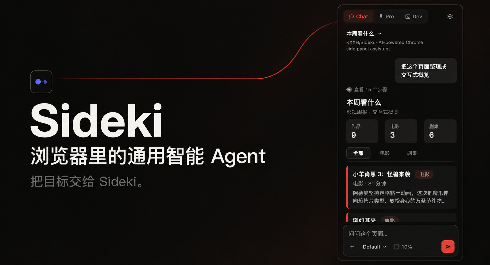

# Sideki



Sideki 是一个运行在 Chrome 侧面板中的通用智能 Agent。

你可以用自然语言，把绝大多数网页任务直接交给 Sideki，让它理解目标、规划步骤并执行。我们相信，通用 Agent 能够以很高的效率完成这些任务，让你专注于想要的结果。

## 快速开始

1. 前往 [Releases](https://github.com/KXXH/Sideki/releases/latest)，下载 `Sideki-v版本号.zip`。
2. 解压到一个固定目录。
3. 打开 `chrome://extensions/`，启用右上角的**开发者模式**。
4. 点击**加载已解压的扩展程序**，选择包含 `manifest.json` 的目录。
5. 点击 Sideki 扩展图标，按引导连接模型。

更新前可在设置中导出备份。将新版文件更新到原加载目录，再在扩展管理页点击**重新加载**。

## 推荐配置

我们推荐使用 **DeepSeek 官方 API 的 DeepSeek-V4.1-Flash**：

| 配置 | 推荐值 |
|---|---|
| API 地址 | `https://api.deepseek.com` |
| API Key | 你的 DeepSeek API Key |
| 模型名称 | `deepseek-flash` |
| Sideki 上下文窗口 | `400000`（400K） |
| 思考强度 | `high`（高） |

我们建议优先使用 Flash 级别的模型，在响应时间、成本与智能之间取得平衡。你也可以在设置中添加其他模型服务。

Sideki 专为缓存友好设计，通过复用稳定的上下文提高缓存命中率。配合 DeepSeek 官方 API 的[缓存计费](https://api-docs.deepseek.com/quick_start/pricing/)，可以降低连续对话和多步任务的输入成本。

## 网络搜索

推荐接入 [Exa Search MCP](https://exa.ai/mcp)，为 Sideki 提供更好的网络搜索能力。

在设置的 MCP 配置中添加服务地址：

```text
https://mcp.exa.ai/mcp
```

## 数据与隐私

Sideki 没有自建后端服务。

对话、配置和附件默认保存在浏览器本地。模型调用与 MCP 请求由浏览器直接发送到你自行配置的服务，不经过 Sideki 服务器中转。

设置中提供数据导入和导出。我们建议在升级 Sideki 版本前，进行一次完整的数据备份。

## 使用边界

- `chrome://` 等浏览器内部页面受到 Chrome 的访问限制。
- PDF 文本提取不包含扫描件 OCR。
- 内置 Shell 使用会话中的虚拟文件系统。
- HTML 画布默认离线运行。
- 后台任务需要浏览器运行、设备处于唤醒状态；浏览器重启后任务会暂停。

## 从源码开发

需要 Node.js 24。

```bash
git clone https://github.com/KXXH/Sideki.git
cd Sideki
npm ci
npm run dev
```

开发服务默认使用端口 `5174`。在 Chrome 中加载 `dist-dev/`，并保持开发服务运行。

| 命令 | 用途 |
|---|---|
| `npm run dev` | 开发模式，输出到 `dist-dev/` |
| `npm run build` | 生产构建，输出到 `dist/` |
| `npm test` | 自动化测试 |
| `npm run lint` | ESLint 检查 |

## 即将推出

**自动审批 · Coming soon**
