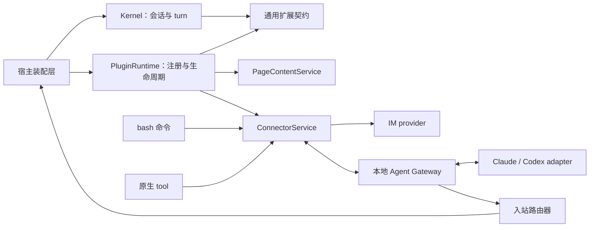

# 连接器与插件架构提案

状态：研究提案，尚未实现。调研日期：2026-10-28。当前行为以源码为准。

目标是关注点分离：Sideki 内核只负责会话与执行，外部通信和站点业务由扩展模块提供。一期在主仓库内静态注册插件；独立仓库、运行时安装、插件市场和独立更新留到后续。现有 CC Bridge 使用率较低，可以替换其实现和协议，不必为了保留旧桥接行为扭曲新架构。

## 1. 建议的概念边界

| 概念 | 职责 | 示例 |
|---|---|---|
| Kernel | 会话、消息、turn、队列、取消、上下文与持久化语义 | `SidekickKernel`、`SessionRuntime` |
| 扩展契约 | 定义可替换能力、类型化 hook、注册与释放接口 | 页面提取、工具贡献、turn 完成事件 |
| Plugin | 一组扩展贡献的生命周期和配置单元 | 钉钉文档插件、连接器插件 |
| Connector provider | 实现某种外部系统的认证、消息协议和能力 | 钉钉机器人、Claude Code、Codex |
| Connection | 用户配置的一条具体连接 | “研发群”“当前项目 Codex” |
| Binding | 外部会话与 Sideki 会话/页面的显式映射 | connection + conversation → session + tab |
| Skill / MCP | 工作方法与外部工具协议，可由插件贡献 | 钉钉文档操作技能、Gateway 对外的 Sideki 工具 |

**插件是通用扩展机制；连接器是插件可以提供的一类能力。** 二者可以有独立的设置入口，但共用注册、配置、生命周期和诊断机制。普通页面插件不需要建立连接，连接器也不需要修改页面提取。

“bash / 原生双模”指同一个动作可以通过 `just-bash` 命令和模型原生 tool 调用，不指 Chrome Native Messaging，也不表示虚拟 Bash 可以启动本机进程。



这是依赖关系图，不表示所有模块在同一个 JavaScript 环境中执行。跨 SW、offscreen、panel 和页面的调用必须通过宿主 RPC。

## 2. DeepSeek Harness 可以借鉴什么

已阅读官方架构文档、Cordis primer、工具注册文档及 Harness 仓库的 `packages/core/tools/src/events.ts`。DeepSeek Harness 将模型适配、工具、会话日志乃至 agent loop 都做成 Cordis 插件，通过服务接口、类型化事件和可撤销的注册组合起来。[官方架构](https://github.com/deepseek-ai/deepseek-harness/blob/master/docs/architecture.md)

适合 Sideki 的三个原则：

1. **消费者依赖接口，provider 实现能力。** 页面读取工具依赖 `PageContentService`，不依赖钉钉；发送工具依赖 `ConnectorService`，不依赖某个 IM 或 CLI。
2. **hook 必须定义调度语义。** Cordis 区分观察、串行、并行、首个接管以及 around middleware；其 waterfall 通过 `next()` 委派，并不是普通事件广播。[Cordis primer](https://github.com/deepseek-ai/deepseek-harness/blob/master/docs/cordis-primer.md)
3. **注册必须可释放。** 工具、监听器、provider、连接和会话资源都要有 disposer，避免切会话、禁用或重建后重复注册。

DeepSeek 的工具管线还区分执行前策略、执行包装、结果处理和最终结果观察，底层 guard 的拒绝不能被后续插件重新放行。这比提供一个任意修改工具调用的 `beforeTool` 更有价值。[工具管线](https://github.com/deepseek-ai/deepseek-harness/blob/master/packages/core/tools/README.md)、[事件类型源码](https://github.com/deepseek-ai/deepseek-harness/blob/master/packages/core/tools/src/events.ts)

一期建议实现较小的类型化 registry 和 hook dispatcher，不直接引入完整 Harness，也不把整个 Kernel 改造成插件。是否复用 Cordis 本体，可以在小型构建实验后决定；需要实际检查其浏览器依赖、SW 产物与生命周期适配，不能凭框架概念判断兼容性。

## 3. 当前源码揭示的迁移点

| 当前入口 | 已有行为 | 对方案的影响 |
|---|---|---|
| `src/background/service-worker.ts`：`handleExtractContent` / `extractBySelector` | 首次页面上下文匹配站点规则，进入所有 frame 查找编辑器，处理 DOM、图片 | 钉钉业务不仅是一个 selector，还包含页面侧清洗和图片提取 |
| `src/shared/site-rules.ts` | 内置钉钉域名和 `[data-role="docEditorContent"]` | 应由页面插件贡献 |
| `src/shared/parser.ts`：`parsePageContent` | 站点规则优先，之后 Readability 和正文 fallback | 应从通用 parser 移除站点识别，保留通用解析能力 |
| `src/shared/tools/page-tools.ts` → `tool-handlers.ts` | `getPageContent` 先选择主要 frame，再把 HTML 交给 parser | 与首次提取不是同一条链路 |
| `src/background/shell-commands.ts`：`page-content` | 默认在页面中把 HTML 转成文本；`--html` 返回原始 HTML | 必须同步接入插件，否则 bash 与原生读取结果会分叉 |
| `src/background/mcp-commands.ts` | 同一 MCP handler 已被 bash 包装调用 | 可借鉴双入口共享执行层，但不能照搬其所有会话/授权边界 |
| `src/shared/tools/bridge.ts`：`sendToolMessage` | 通用 helper 会解析操作 tab | 纯消息发送应有不获取 tab 锁的调用路径 |
| `src/sidepanel/views/ChatView.tsx` | 监听 `bridge:message`，在 Pro 面板发起 turn | 入站依赖面板，应移至宿主路由层 |
| `src/shared/kernel/kernel-runtime.ts` / `useSidekickChat.ts` | Pro 回复按文本长度直接回传 CC | 供应商名称和回传策略已经进入执行层，需要移出 |
| `tools/sidekick-bridge/scripts/bridge.js` | 单 WS client、内存事件数组、时间戳拉取，无 session 路由 | 可以保留本地服务形态，重做协议和路由 |
| `src/offscreen/main.ts`：`schedule:wake` | 已可 retain runtime、无面板发起执行、完成后 release | 可提炼通用后台派发服务，不要把连接器伪装成定时任务 |

额外发现：`handleExtractContent(tabId)` 当前使用窗口 active tab 的 URL 匹配规则，再向参数 `tabId` 注入。统一提取时应改为读取指定 tab，并在导航后验证 document 身份，避免规则和实际目标错配。

已有 `dingtalk-docs` skill 的职责是通过 MCP 操作文档，和这里的 DOM 阅读适配不同。可以以后打包为同一插件的两个贡献，但 DOM 自动提取不应以 MCP 已配置为前提。

## 4. 内核与插件如何分离

### 4.1 依赖方向

内核只依赖通用契约和宿主注入的 ports，不导入 `plugins/*`、`connectors/*`、IM SDK 或 CC/Codex adapter。`PluginRuntime` 在宿主装配层注册 provider，装配工具和订阅内核事件。

内核可以表达“一个输入来自外部”“这个 turn 已结束”，但不负责识别钉钉群、Claude session、Webhook URL 或回传目标。具体路由保存在连接器服务中；消息仅保存通用的来源与关联 ID。保留旧消息 `source: 'claude-code'` / `relayed` 的兼容读取，不再生成新的供应商专用分支。

判断分离是否成功的标准：新增第三种 IM 时，只增加一个 provider 和注册配置；删除全部连接器后，内核仍可构建、测试和运行。

### 4.2 执行环境

| 环境 | 承担职责 | 不应放入 |
|---|---|---|
| SW | Chrome API、页面注入、ConnectorService、连接配置与收发持久化、网络请求和重连 alarm | DOMParser、Readability、Node SDK、动态 `import()` |
| Offscreen | 默认会话宿主、PluginRuntime 的会话作用域、DOM 解析服务、后台消息派发 | 直接 storage/tabs/scripting 调用 |
| Panel | 配置、连接状态、审批与诊断；本地宿主模式复用同一装配契约 | 唯一的入站监听器和回传实现 |
| 页面脚本 | 站点 DOM 读取、必要的页面图片处理 | 连接凭据、外部会话控制 |
| 本地 Gateway | 本机进程、Claude/Codex adapter、stdio/流事件转换 | Sideki 的会话内核和页面业务 |

SW 注册清单使用顶层静态 import；DOM 相关插件入口单独打包。插件可按需声明 `background`、`document`、`page` 入口，第一版不开放任意 UI 扩展。不能把一个包含所有依赖的插件入口同时导入三个环境。

### 4.3 注册与 hook

以下 API 名称均为提案，不是现有接口。

| 扩展点 | 语义 | 一期安排 |
|---|---|---|
| `pages.registerExtractor` / `page.extract` | 按明确顺序尝试 provider，第一个返回有效结果者接管 | 实现，用于钉钉 |
| `tools.register`、`commands.register` | 贡献能力的原生/bash 包装，返回 disposer | 实现，用于连接器 |
| `connectors.registerProvider` | 注册连接协议和能力声明 | 实现 |
| `turn.settled` | 观察成功、失败、取消等最终结果，不能重新解释执行是否成功 | 实现，用于关联回传 |
| `session.disposed` | 清理作用域资源 | 实现 |
| `context.prepare` | 向请求副本贡献结构化上下文；不得改写早期历史 | 保留契约，按真实需求启用 |
| `tool.beforeExecute` | 串行 gate，可增加限制；最终授权仍由宿主判定 | 随统一动作执行层逐步接入 |
| `tool.afterExecute` | 处理模型可见结果副本；外部副作用状态保持真实 | 随实际插件需求接入 |

不把“注册能力”“替换实现”“观察事实”全部混成一个全局事件总线。每个 hook 明确输入输出、执行环境、是否等待、顺序、取消和错误处理。

同一 hook 按 `priority`、注册序号稳定排序；相同能力名冲突默认报错。提取插件超时/异常时记录诊断并尝试下一个 provider；授权 gate 失败则阻止该动作，不能当作未命中而继续。观察插件报错不改写已经完成的 turn。

一个 turn 使用确定的插件/工具注册版本。新增能力在下一安全边界生效；移除连接或撤销权限立即阻止新调用，不在活跃 turn 中悄悄替换模型可见 schema。只有改变工具定义和冻结提示词的贡献版本才纳入两宿主共用的 `agentFingerprint`；会话选择变化通过每轮 capability snapshot 和 `activeTools` 表达，连接健康状态不触发重建。页面切换仍不应触发全量 agent 重建。具体产品语义见第 10 节。

一期插件是受信任的打包代码，接口约束是架构边界，不是恶意插件的安全沙箱；真正第三方动态代码需要另做隔离设计。

## 5. 连接器：双入口、一个执行层

### 5.1 执行模型

```text
模型原生 connectorSend / connectorRequest ─┐
                                         ├─ ConnectorService.execute(action, trustedContext)
just-bash connector send / request ────────┘
                                            → 参数校验与目标解析
                                            → hooks 与宿主授权
                                            → 持久队列 / provider
                                            → 统一结构化结果
```

两条入口共用参数 schema、授权、幂等键、取消和结果状态，只在最外层适配 tool result 或 stdout/stderr。不能让 bash 直接 `fetch` Webhook，而原生工具才经过确认。

例如，以下两种调用应命中同一个 action：

```bash
cat /notes/report.md | connector send --connection team-im --text-stdin
```

```json
{
  "connectionId": "team-im",
  "text": "本次排查结果……"
}
```

模型仅看到连接别名、能力与必要目标信息，不看到 token、Webhook 签名密钥或本机启动命令。文件输入仅解释为当前会话 VFS 文件。纯消息动作不要求有网页，也不申请 tab 操作锁；需要浏览器能力的入站任务才使用显式绑定的 tab。

只开放少量稳定入口，如 list/send/request/status/cancel；按连接能力决定可用操作，不为每个群生成一个工具。`send` 是消息交付，`request` 是可跟踪的外部任务，不能都返回含糊的 `success: true`。

### 5.2 Provider 与消息协议

建议 provider 能力声明使用 `send`、`receive`、`request`、`cancel`、`stream` 等独立项。IM 一期只需要 send；Agent provider 支持 request/receive，必要时增加 cancel 和审批事件。没有能力的操作直接报不支持，不模拟成功。

建议统一信封包含：

```ts
interface ConnectorEnvelope {
  version: 1
  id: string
  connectionId: string
  conversationId: string
  kind: 'message' | 'request' | 'response' | 'event'
  correlationId: string
  causationId?: string
  replyTo?: string
  origin: string
  hops: number
  createdAt: number
  payload: unknown
}
```

实际实现使用按 kind 区分的 schema，而不是直接接受任意 `unknown`。`connectionId` 和 origin 根据认证后的通道确定，不能相信模型或外部 payload 自报的身份。`sessionId`、`tabId`、权限和路由由宿主解析后的 trusted context 提供；外部调用方只能请求已授权的 binding。

明确区分本地 `queued`、provider 接受的 `accepted`、任务 `completed`、`failed`、`cancelled`、`unknown`。Webhook 返回接受不代表接收人已读；WebSocket write 成功也不代表对端已经处理。

### 5.3 路由、恢复和外部副作用

- 入站先持久化、去重，再按 binding 找到 session；通过 offscreen 宿主服务 retain runtime、排队、执行和 release，关闭面板不影响正常后台路线。
- 忙碌 session 默认排队，不自动打断；未绑定目标不能落入“当前面板会话”。运行中保持 turn 的 tab 栈，不能逐步重新解析窗口 active tab。
- 一期后台入站依赖默认 offscreen 宿主。选择 panel 排障宿主时应明确暂停无人值守接收，或只在 panel 在线时按单一所有者派发，不能同时启动两个宿主消费同一 session。
- 浏览器重启后，连接可以恢复，但涉及浏览器操作的旧 binding 必须验证并按既有后台任务规则重新确认；不能自动选当前活动页替代。
- 只有具有回传路由的请求才自动返回最终结果。用户正常 Pro 对话不再全部广播到外部；主动向 IM 分享通过 send 工具或明确配置的通知规则。
- 流式进度只更新任务状态/UI，不能把每个 token 当成新 user turn；最终 response 通过 correlation 匹配任务，再作为结果或带来源的队列消息进入会话。
- 是否允许外部 request 启动 turn 由 binding 权限决定；外部消息正文始终是带来源的输入或工具数据，不能提升为系统指令或伪装成用户批准。
- 持久 inbox/outbox、单调序号和去重记录替代内存数组与纯时间戳游标；网络重试使用退避、截止时间和 `chrome.alarms` 恢复入口。
- 外部发送和本地存储无法组成分布式事务。请求超时但对方可能已收到时记为 unknown；仅在平台支持幂等键或已确认未发送时安全重试，不承诺 exactly-once。
- `turn.settled` 具有稳定 turn/message ID，宿主保证最终消息保存后生成投递记录，并用请求路由记录做崩溃恢复对账。不要仅用 fire-and-forget 监听器承担可靠回传，也无需为此重写整个内核为事件溯源系统。
- 停止操作只能取消尚未发送的消息或请求 provider 停止任务；已发出的 IM 消息不自动撤回。VFS 回滚与外部发送结果分别记录。
- Gateway 的配对认证、路由授权、来源校验、payload 上限必须随新协议实现；当前 localhost + 任意 CORS 不能作为新设计的身份认证。

配置凭据由宿主保管，模型参数、会话历史、VFS 和普通诊断不携带原始 secret；备份是否包含凭据必须显式定义。宿主存储本身不能被宣称为抵御本机恶意程序的加密保险箱。

## 6. Claude Code / Codex 的推荐路径

一期建议由本地 Agent Gateway 创建或恢复明确绑定的专用会话。它复用 `tools/sidekick-bridge/` 的本地服务定位，但重做会话协议，不再与 Pro debugger attach/detach 耦合；备份 daemon :9333 仍是另一服务。

| 接入对象 | 官方能力 | 建议 |
|---|---|---|
| Claude Agent SDK | Streaming input 支持持续会话、输入队列、流输出、中断和权限请求 | 一期默认 adapter，由 Gateway 管理会话 |
| Claude Channels | 向已打开的 Claude Code session 推入事件，通过 reply tool 双向通信 | 后续 existing-session adapter；目前有 research preview 和自定义 channel 加载限制 |
| Codex app-server | thread/turn、流事件、取消、审批，JSON-RPC 双向通信 | 一期深度集成 adapter，Gateway 优先使用本机 stdio |
| Codex SDK | 程序化启动、继续、恢复任务 | 若最终仅需要后台任务执行，可用较小的 SDK adapter |

Claude 的持续交互由官方 Agent SDK streaming input 文档确认。[Claude SDK](https://code.claude.com/docs/en/agent-sdk/streaming-vs-single-mode)

Claude Channels 是连接现有会话的实际可行方向，但目前 custom channel 不在预览允许列表中，测试需使用专用开发加载参数；不宜把无条件可安装作为一期前提。[Channels](https://code.claude.com/docs/en/channels)、[Channels reference](https://code.claude.com/docs/en/channels-reference)

Codex app-server 支持 `thread/start` / `thread/resume`、`turn/start` / `turn/steer` / `turn/interrupt` 和审批请求。官方当前把 app-server 命令及 WebSocket transport 标为实验性质；选择 stdio 是减少桥接层变量，不等于消除版本风险。应锁定支持版本、生成对应 schema 并做连接握手与能力检测。[OpenAI 官方 app-server 文档](https://learn.chatgpt.com/docs/app-server)

现有 Codex 会话的连接也值得保留 adapter 空间，官方 CLI 已列出 remote transport 和向现有会话排队的命令；但“恢复历史会话”和“连接另一个客户端当前正在运行的会话”不是同一保证，不能通过启动一个新进程就声称接管成功。[OpenAI 官方开发命令](https://learn.chatgpt.com/docs/developer-commands)

双向交互应包括两个明确流程：

1. Sideki → Agent：connector request 创建任务，Gateway 发给绑定的 Claude/Codex session，返回 task ID，随后推送进度和最终结果。
2. Agent → Sideki：Gateway 对外提供受限的 MCP 请求入口，外部 agent 显式请求已配对的 Sideki 会话完成任务。请求进入同一个入站路由器，最终结果按 correlation 返回。

这不只是读取 CLI stdout，也不依赖在终端窗口里模拟键盘输入。外部模型、登录、工作目录与进程生命周期由 adapter 管理，不能复用 Sideki 的 `config.model` 充当外部模型身份。

**必须避免递归等待。** Sideki 请求外部 Agent 的工具立即返回任务凭据，不能占住 5 秒/30 秒 Bash 调用等几分钟。外部任务再请求同一 Sideki 会话时采用可排队的异步请求；若形成“当前 turn 等待对方、对方又等待当前 session/tab”的依赖环，明确返回 busy/reentrant-dependency，不能互相轮询。先支持异步双向协作，再按需求设计同步浏览器委派和 tab 锁移交。

审批请求是控制事件，由有权限的 UI/用户答复；外部 agent 的回复文本不能等价于用户批准。对话自动往返有 hop 限制、任务预算和停止入口，只对显式 request 产生执行，不把所有 response 再升级为新 request。

## 7. 钉钉文档插件：先统一提取能力，再迁移业务

目标是让三种默认正文入口共用 `PageContentService.read()`：

```text
首次上下文提取 ─┐
getPageContent ─┼─ PageContentService
page-content ──┘    → 解析明确的 tab / frame / document
                    → 按 URL 和能力筛选 extractor
                    → 钉钉 extractor / 其他 extractor
                    → 内置通用 extractor 兜底
                    → 正文、图片与来源元数据
```

`page-content --html` 保持显式原始 HTML 读取语义，不悄悄换成 Markdown。三种入口可以继续保留各自的展示长度限制，但必须使用相同正文来源和 frame 选择规则。

建议结果契约：

```ts
interface ExtractedPage {
  title: string
  url: string
  content: string
  format: 'text' | 'markdown'
  images?: Array<{ id: string; dataUrl?: string; url?: string }>
  source: {
    extractorId: string
    tabId: number
    frameId: number
    documentId?: string
  }
  completeness: 'complete' | 'partial' | 'unknown'
  warnings?: string[]
}
```

显式 `frame` 是硬约束，插件不能为了匹配站点转读其他 frame。未指定 frame 时，基于目标 tab 及其 frame 的真实 URL/DOM 选择 extractor；不默认顶层 URL 等于文档 iframe URL。

钉钉插件拥有域名匹配、编辑器根选择、站点噪声层处理、DOM 到 Markdown 的业务转换和站点专用图片策略。核心保留 frame 发现、受控注入、通用 Markdown 转换、容量/时间限制和通用回退。已有去除不可见字符的通用处理是否保留，由其跨站用途决定，不因首次观察于钉钉就全部搬走。

钉钉页面采集脚本编译成独立、随扩展打包的文件，用浏览器注入入口运行；不能把引用了外部 import 的函数直接塞进 `executeScript({ func })`。页面采集与 offscreen DOM 转换分工明确，需要 MAIN world 的部分显式声明，其余尽量用隔离环境。

为避免 SW 混入 DOM 依赖：SW 负责 page capture，通用解析/插件文档转换在 offscreen 的独立 RPC 服务完成；两种模型宿主都使用同一提取服务。该解析服务不依赖某个 Kernel 正在执行，因此 bash 工具调用也不会递归阻塞当前 turn。

提取器返回 `handled / not-applicable / failed` 的区分结果。未命中、空内容、超时或异常时继续兜底并记录 extractor 诊断；不要因为 URL 匹配就直接把空结果当成功。延迟渲染要有统一截止时间、取消信号、导航失效检查和结果大小上限。开放 ShadowRoot 可遍历，关闭的 ShadowRoot 和虚拟化未渲染内容不能凭 DOM 读取保证完整；应标注 partial/unknown，而不是宣称完整文档。

Chat 首次正文冻结策略保留：插件接管“如何获取正文”，不改变“何时刷新正文”。插件变化只影响下一次提取；历史消息和已有冻结上下文不被后台重写。

## 8. 代码组织与实施切片

建议先在当前仓库建立边界，以下为逻辑结构，具体文件按首次实现规模合并：

```text
src/shared/extensions/       契约、registry、hook 调度、贡献版本
src/background/extensions/   SW 装配、执行与权限适配
src/offscreen/extensions/    会话作用域装配、DOM 转换与入站派发
src/shared/connectors/       协议、能力描述、connection / binding 类型
src/background/connectors/   服务、inbox / outbox、路由与传输
src/shared/page-content/     提取请求和统一结果契约
src/plugins/dingtalk-docs/   钉钉页面采集与文档转换
src/plugins/im-webhook/      首个 IM provider
src/plugins/agent-gateway/   扩展侧 Gateway provider
tools/sidekick-bridge/       本地 Gateway 与 Claude/Codex adapters
```

`extensions` / `connectors` 的通用文件不得反向导入具体插件；静态清单放在装配层。以后拆仓时导出公开契约并将插件变为包依赖，不改变核心调用方。

建议按以下可验收切片推进，而不是先写完整插件平台：

| 切片 | 交付 | 验收重点 |
|---|---|---|
| A：提取插件化 | 最小 PluginRuntime、page provider、统一三条正文入口、迁移钉钉业务 | 启用插件三入口一致；禁用恢复通用提取；跨 frame、导航、空结果正确 |
| B：IM 发送 | ConnectorService、connection 配置、同一动作的 bash/原生入口、首个 IM provider | 两入口同授权同结果；无网页可发送；凭据不进入模型；失败不虚报成功 |
| C：Agent 双向 | Gateway、Claude/Codex adapters、绑定路由、无面板派发、任务结果关联 | 两 session 不串线；关闭面板可继续；取消/审批/断线恢复；无反馈循环与等待死锁 |
| D：完善扩展 | 按真实需求添加 context/tool hooks、诊断 UI、插件配置迁移 | 两宿主一致、卸载清理、注册版本生效可预测 |

一期目标包含 A–C；D 按实际需求扩充。UI 暂时只需要“连接器：配置/绑定/状态/发送记录”和“插件：启用状态/配置/诊断”，无需先做商店。

实现时的必要验证包括：共享动作授权测试；提取 fallback 与 frame 指定测试；入站重复投递、乱序和多会话测试；Gateway 中断与未知发送状态测试；依赖边界检查；构建后检查 SW 产物无动态 import 和 DOM/Node 依赖。真 Chrome 验收覆盖 SW 挂起、offscreen 重建、关闭面板、iframe/Shadow DOM 和 localhost 连接。

研究阶段没有运行这些实现测试，因为本提案尚未改动运行时代码。

## 9. 后续动态插件的约束

MV3 与 Chrome Web Store 对远程代码执行有专门约束，不能把 npm 插件下载到 storage 后在 SW/面板里直接 import/eval。User Scripts、Debugger、隔离 sandbox 有各自的适用条件，并不是一套完整插件宿主的通行证。[Chrome 官方 MV3 要求](https://developer.chrome.com/docs/webstore/program-policies/mv3-requirements)

当前最合适的是随扩展打包、静态注册、运行时可启停的内部插件。未来独立仓库可以先通过构建依赖实现；真正运行时安装则另做基于能力 RPC 的隔离宿主设计。现有画布 sandbox 没有宿主 DOM/Chrome API，不能直接拿来运行钉钉页面提取插件。也不应通过把可执行逻辑伪装成 JSON 规则解释器规避分发约束。

架构取舍是：先建立稳定、可测试的能力边界，再扩展分发机制。钉钉 extractor 和 IM/Agent connector 两类性质不同的实现，就是检验这套边界是否足够通用的首批样本。

## 10. 产品形态与会话能力生命周期

本节是对产品交互和声明格式的进一步建议，所有新增字段和 API 均为设计示例。

### 10.1 用户看到什么

建议在设置中增加“扩展”，包含“插件”和“我的连接”两部分：

- 插件展示名称、用途、启用状态、配置与诊断。例如钉钉文档卡片显示“自动增强钉钉文档阅读”；用户不需要理解 hook 名称。
- 我的连接保存具体连接实例，例如“钉钉 · 研发群”“Codex · sidekick 项目”。配置账户/凭据、目标、Gateway 和默认权限，并提供状态检测。检测连接不隐式发送消息或启动模型任务。
- 一个插件可以提供多个贡献；一个连接器 provider 可以配置多个连接实例。安装/启用插件、配置连接、授权某个会话使用是不同操作。

会话输入框增加连接器按钮和已选连接标签。按钮打开弹层，按具体连接实例选择：

```text
本会话的连接器

☑ 钉钉 · 研发群          可用       发送消息
☑ Codex · sidekick       就绪       委派任务
  接受外部新任务         关闭
☐ Claude · 文档项目      未启动

+ 添加连接                管理连接
```

输入框上方可显示“钉钉·研发群”“Codex·sidekick”两个紧凑标签；点击标签查看状态、可用动作、绑定目标、任务和移除操作。已选但离线的标签保留并显示离线，不伪装成用户取消选择。

“用于本会话”意味着模型可以在任务需要时使用该连接，具体发送仍走已有动作授权。“接受外部新任务”是单独的入站授权，默认关闭；接收自己委派任务的关联结果不需要开启这个选项。入站授权也不等于允许外部批准工具操作。

选择连接不自动同步整个聊天历史。委派动作传递任务说明和明确选择的内容；持续会话的增量内容属于其外部任务记录，不默认镜像全部 Sideki 对话。

新建会话默认没有外部连接；可后续提供用户设置的默认组合。恢复同一个会话保留所选连接；复制/分叉会话不复制活动入站 binding 或直接复用外部运行中会话。浏览器重启后的自动接收和页面绑定按后台恢复规则重新验证。

钉钉 DOM 插件使用另一种交互：全局启用后，遇到匹配页面自动参与提取，在页面上下文区域显示“正文来源：钉钉文档”。可提供“本会话使用通用提取”的覆盖选项，不必每次阅读都把插件加到连接器列表。已冻结的正文仅在明确刷新后重新提取。

### 10.2 不把授权状态和传输状态合并为一个开关

| 状态/操作 | 含义 | 对任务的影响 |
|---|---|---|
| 插件启用 | 已注册相应能力 | 不自动授权全部会话 |
| 连接已配置 | 目标与凭据已保存 | 不自动启动 Agent 模型任务 |
| 用于本会话 | 本会话可选择该连接的动作 | 后续提交的消息携带该选择 |
| 接受外部新任务 | 允许已配对对端主动向本会话派发请求 | 建立/恢复入站监听与 binding |
| 在线/离线/待认证 | 当前传输可用性 | 影响动作成功与重连，不改变会话选择 |
| 从会话移除 | 撤销本会话对该连接的使用 | 立即拒绝新动作；下一轮不再暴露 |
| 停止外部任务 | 对特定 task 发起取消 | 不等价于移除连接；不承诺撤销已发生的副作用 |
| 全局禁用连接/插件 | 所有绑定禁止新使用 | 释放无引用资源，活动任务按取消协议处理 |

IM 发送类连接无需长期后台进程，调用时发送。Agent 连接用于主动委派时可在首次请求时启动专用进程/会话；开启外部新任务接收时建立监听，但不因此开始模型推理。关闭面板不改变会话绑定；从一个会话移除连接也不应关闭其他会话仍在使用的共享 Gateway 传输。

### 10.3 插件怎样声明自己

建议使用“可序列化 manifest + 静态注册的实现入口”。manifest 描述身份、API 版本、能力贡献、适用范围、所需宿主能力和配置 schema；实现负责绑定已声明的 handler，注册返回 disposer。宿主决定 hook 的调度模式和最终授权，插件不能自行声明绕过策略。

钉钉文档插件示例：

```json
{
  "id": "sideki.dingtalk-docs",
  "name": "钉钉文档",
  "version": "0.1.0",
  "apiVersion": 1,
  "description": "提取钉钉文档的正文、表格和图片",
  "requires": ["page.capture", "document.transform"],
  "contributes": {
    "pageExtractors": [{
      "id": "document",
      "activation": "page-match",
      "matches": [
        "https://alidocs.dingtalk.com/i/nodes/*",
        "https://docs.dingtalk.com/i/nodes/*"
      ],
      "priority": 100,
      "handler": "extract-document"
    }]
  }
}
```

连接器插件的贡献示例，外层身份字段同上：

```json
{
  "id": "sideki.codex",
  "name": "Codex",
  "version": "0.1.0",
  "apiVersion": 1,
  "requires": ["gateway.agent"],
  "contributes": {
    "connectors": [{
      "id": "codex",
      "activation": "session-selection",
      "actions": ["request", "status", "cancel"],
      "inbound": ["response", "task"],
      "handler": "codex-provider",
      "configSchema": {
        "type": "object",
        "properties": {
          "gatewayId": {"type": "string", "title": "本地 Gateway"},
          "projectId": {"type": "string", "title": "工作项目"}
        },
        "required": ["gatewayId", "projectId"]
      }
    }]
  }
}
```

`handler` 是构建时注册表中的稳定键，不是运行时下载/import 的地址。构建检查 handler 是否存在、环境是否匹配、贡献 ID 是否重复。页面采集、document 转换、SW provider 分别映射到独立静态入口；不能用 manifest 将 DOM 代码带入 SW。

普通 hook 贡献也在 manifest 中声明 event 和 handler，类型由 SDK 定义。例如 `turn.settled` 只能收到被授权作用域内的结果。连接器 provider 通常只实现协议，由通用连接器层按 binding 处理回传，不要求每个 provider 自行订阅所有会话。

`requires` 是所需宿主能力的声明，不是已获得的授权。连接凭据存于 connection 实例的宿主 secret 引用中，不写入 manifest。激活条件属于各个贡献，避免一个同时提供页面能力和连接器的插件只能选择一种整体激活方式。

### 10.4 选择可以变化，执行轮次有快照

推荐以 turn 为模型能力生效边界，而不是以 session 创建时刻或每个模型 step 为边界。一个 turn 指一条输入引发的完整模型/工具循环。

```text
全局可用贡献
     + 本会话所选连接
     + 本条输入的选择记录
     + 当前宿主授权
           ↓
    TurnCapabilitySnapshot
           ↓
    模型可见工具与连接目录
           ↓
    每次实际执行再次检查实时授权
```

三层数据分开保存：

- SessionExtensionState：当前会话选择的 binding、允许动作、是否接受外部新任务、页面插件覆盖和 revision。由扩展服务持久化并随 session 删除/导出/恢复管理，内核不解释 provider 配置。
- SendIntent：用户点击发送时记录选中的 binding ID 与版本，随队列项保存。已经排队的消息不会因为后来添加了连接而静默获得额外能力。
- TurnCapabilitySnapshot：输入实际开始执行时，在 SendIntent 基础上解析仍有效的绑定、贡献版本与授权，生成固定的工具/连接视图。它不包含凭据。

| 用户操作或事件 | 当前 turn | 后续 turn |
|---|---|---|
| 增加连接 | 不增加工具或目标 | 后续提交的消息可使用 |
| 移除连接或撤销动作权限 | 立即禁止新的相关执行，模型本轮视图可暂时保持旧快照并收到结构化拒绝 | 不再暴露 |
| 开启外部新任务接收 | 可开始监听，新请求按绑定入队 | 每个请求独立做执行准入 |
| 关闭外部新任务接收 | 停止准入，尚未执行的外部请求取消或标为拒绝；已接受任务的关联回复单独处理 | 不再启动外部主动 turn |
| 连接离线/重连 | 保留工具定义，调用反映实际连接状态 | 根据健康状态提示，但不重建 agent |
| 改变发送目标/项目/凭据身份 | 旧绑定不可被静默重定向；使旧授权失效 | 下一次明确发送使用新绑定版本 |
| 插件新增工具定义或修改冻结提示词 | 当前 turn 保持已选版本，必要撤销仍立即执行 | 安全边界重新装配 |

关闭权限需要在授权等待结束、真正派发前再检查，避免确认弹窗等待期间被撤销后仍发送。移除再重新添加连接生成新的 grant generation，旧快照不能因此自动恢复权限。

已经发送到外部的请求继续保留任务记录，最终结果可作为完成事实落库；连接已撤销时不自动驱动新模型 turn。用户可单独停止外部任务或显式导入结果。

### 10.5 动态暴露的实现建议

连接器的原生动作 schema 保持少量稳定定义，例如 `connectorSend`、`connectorRequest`、`connectorStatus`、`connectorCancel`。每轮按已选连接所支持动作的并集过滤这些工具；没有连接时不向模型暴露相应动作。具体 connection ID、别名、可用动作和必要状态通过本轮连接目录提供，不把每个群、每个外部会话生成一套工具。

connection ID 参数使用稳定字符串 schema；服务端按快照与实时 grant 校验，不能因为 schema 没有动态 enum 就接受任何 ID。模型知道旧连接名称或 bash 手写 ID，都不能绕过当前会话范围。

本地 `node_modules/ai/src/agent/tool-loop-agent-settings.ts` 的 `prepareCall` 支持返回 `activeTools`，因此现有依赖有每次调用选择可见工具的接缝。可以让两宿主共用的装配层从 turn snapshot 设置 `activeTools` 和请求副本中的连接目录，而不必为每次勾选连接重建冻结上下文。`activeTools` 仅承担暴露控制，不应被当成完整的执行授权边界。

同一个 turn 的各 step、重试和队列续接必须使用其对应快照。这里“队列续接”指每个队列项各自保持选择记录，不能把前一项的能力泄漏给后一项；共享 tab 栈的现有规则另行保留。`prepareStep` 不随网络状态增删工具或回写早期消息。

bash 命令注册为稳定分发器，执行时接收同一个 turn context；`connector list` 只展示本轮已准入的连接及最新可用状态，`connector send/request` 再做实时检查。两条入口不得分别维护一套可用连接列表。

只有真实的贡献 schema / 冻结提示词版本变化影响 agent 的扩展 fingerprint。会话选择 revision 和传输健康 revision 分别管理。工具子集变化仍可能影响模型服务的工具前缀缓存，因此目标是避免无必要的重建，不承诺任何选择变化都零缓存成本。
